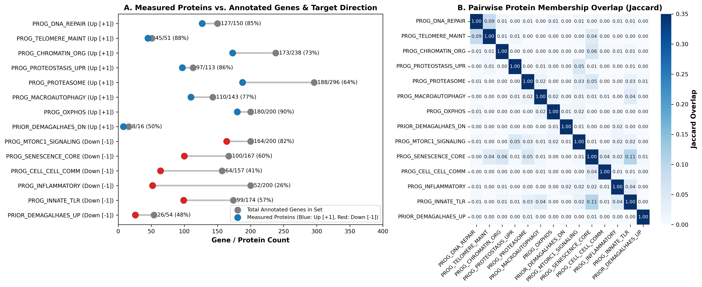
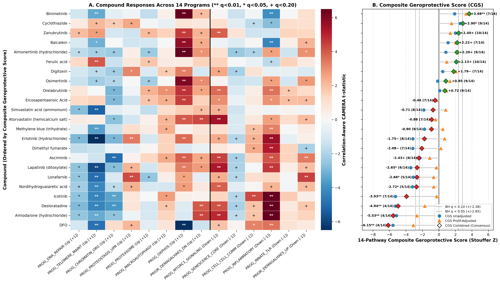
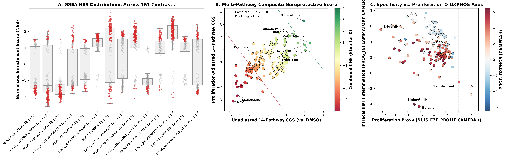
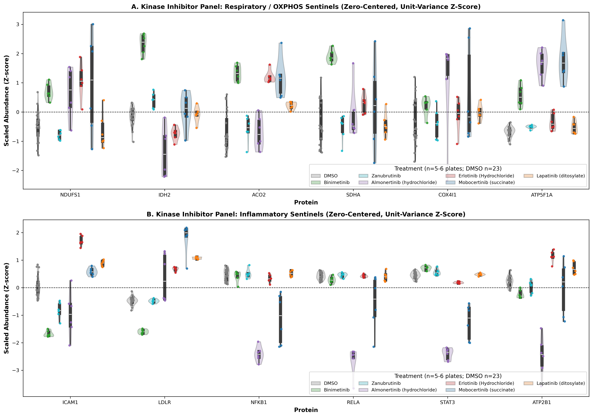
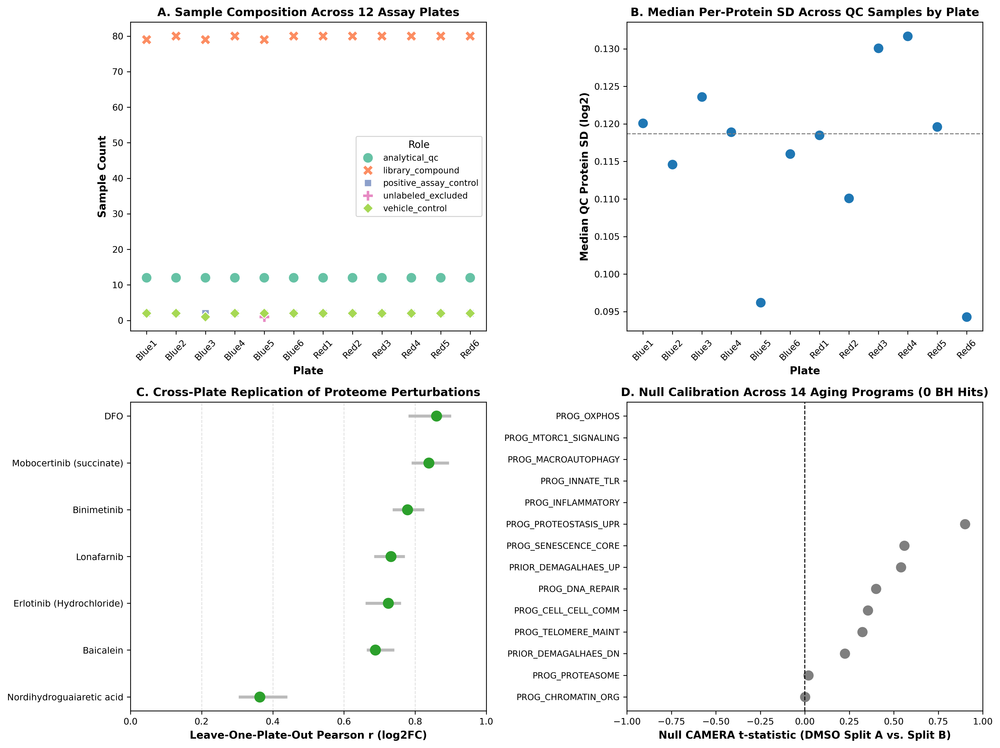
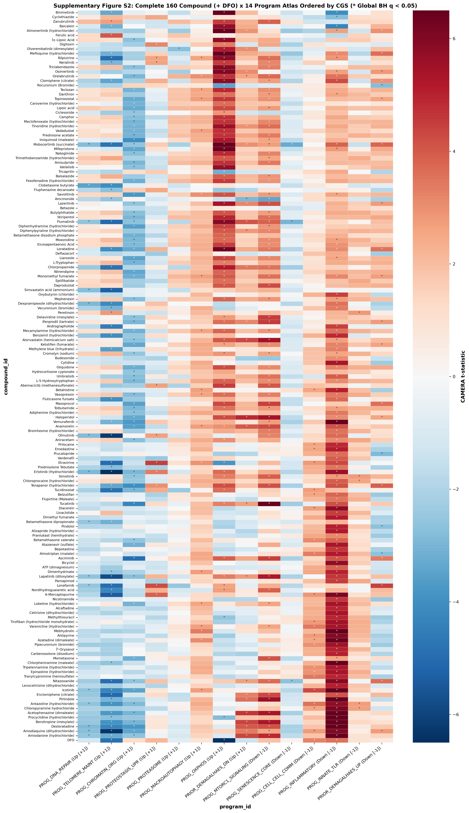
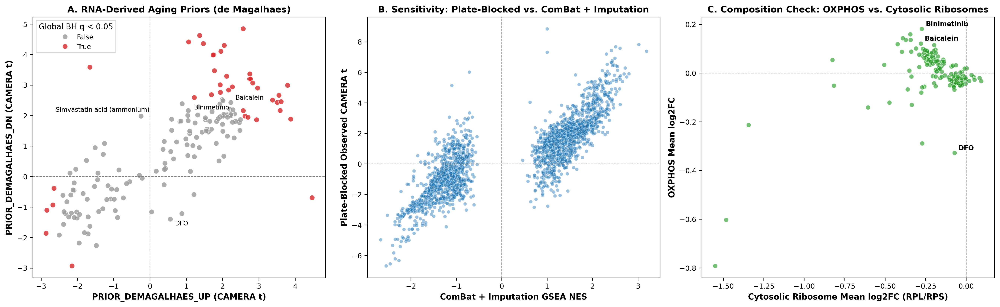

# Proteomic profiling maps pharmacological responses across aging associated cellular programs

## Abstract

High-throughput proteomic screens of small-molecule libraries offer a scalable strategy to evaluate how diverse pharmacological perturbations remodel cellular pathways relevant to aging without relying on single-endpoint reporter assays. However, translating perturbation proteomes into reliable geroprotective nominations requires accounting for batch design, inter-protein correlation within stoichiometric complexes, proliferation confounding in dividing cells, and directional consistency across multiple aging pathways. Here, we present a plate-blocked, correlation-aware reanalysis of a robotic data-independent acquisition (DIA) mass-spectrometry screen in human HepG2 cells (Jiang et al., 2026) spanning 160 library compounds and the hypoxia-mimetic assay control deferoxamine (`DFO`) across 12 balanced assay plates (`Blue1`-`Blue6`, `Red1`-`Red6`; 7,871 proteins retained at <=50% missingness). Across 14 frozen aging-associated protein programs (2,254 compound-program hypotheses), standard correlation-aware competitive testing (`CAMERA`, preset inter-protein correlation rho = 0.01) identified 504 significant compound-program pairs across 159 contrasts at global Benjamini-Hochberg (BH) false discovery rate (FDR) q < 0.05, compared with 826 pairs under permutation Pre-Ranked GSEA and 218 pairs under unregularized empirical variance-inflation scaling. To overcome the limitations of single-pathway nomination, we formulated a correlation-calibrated 14-pathway **Composite Geroprotective Score (`CGS`)** that integrates all 14 programs according to their canonical direction for reduced aging (8 upregulated maintenance/bioenergetic programs and 6 downregulated inflammatory/senescent/hyperfunctional programs) before (`CGS_unadj`) and after (`CGS_adj`) adjusting for E2F/G2M proliferation axes. Across all 161 contrasts, the MEK1/2 inhibitor **binimetinib** ranked #1 in proliferation-adjusted and combined composite scoring (`CGS_adj = +3.29`, `CGS_combined = +3.68`, BH q = 0.0028), driven by strong activation of mitochondrial oxidative phosphorylation (`PROG_OXPHOS` CAMERA t = +7.39, q = 6.1e-11; GSEA NES = +3.13, q = 0.0024) and suppression of intracellular inflammation (`PROG_INFLAMMATORY` CAMERA t = -4.02, q = 8.2e-4; GSEA NES = -1.75, q = 0.0077). The composite score further nominated **cyclothiazide** (`CGS_combined = +2.91`, q = 0.0185; 9/14 programs beneficial vs. DMSO), the covalent Bruton's tyrosine kinase (BTK) inhibitor **zanubrutinib** (`CGS_combined = +2.40`, q = 0.0593; 10/14 adjusted programs beneficial), the flavonoid **baicalein** (`CGS_combined = +2.22`, q = 0.0836), the wild-type-sparing third-generation EGFR inhibitor **almonertinib** (`CGS_combined = +2.20`, q = 0.0870), **ferulic acid** (`CGS_combined = +2.13`, q = 0.0981; 10/14 programs beneficial), and **alpha-lipoic acid** (`CGS_combined = +2.01`, q = 0.1207; 10/14 adjusted programs beneficial, concordant with an independent lipoic acid library entry). Conversely, the composite score cleanly separated pro-aging and cytotoxic perturbations at the opposite tail (BH q <= 0.001), including `DFO` (`CGS_combined = -6.15`, 11/14 programs pro-aging), **amiodarone** (`-5.53`), first-generation wild-type EGFR inhibitors (**icotinib** `-3.93`, **lapatinib** `-2.65`, **erlotinib** `-1.75`), and anticholinergic H1-antihistamines (**desloratadine** `-4.94`, **benztropine** `-4.76`, **procyclidine** `-4.74`). Finally, we design an active-comparator, new-user target-trial emulation in Medicare claims data to test whether multi-pathway proteomic geroprotective nominations translate into real-world human survival benefits.

---

## 1. Introduction

Aging is a complex, multi-system process driven by interconnected molecular, cellular, and systemic alterations codified in the 12 hallmarks of aging: genomic instability, telomere attrition, epigenetic alterations, loss of proteostasis, disabled macroautophagy, deregulated nutrient sensing, mitochondrial dysfunction, cellular senescence, stem cell exhaustion, altered intercellular communication, chronic inflammation, and dysbiosis (Lopez-Otin et al., 2023). Historically, preclinical discovery of geroprotective compounds has relied on phenotypic longevity screens in short-lived model organisms or targeted biochemical reporter assays that measure one pathway at a time. Although targeted in vivo interventions evaluated by the National Institute on Aging (NIA) Interventions Testing Program (ITP) have validated lifespan extension for compounds such as rapamycin (Harrison et al., 2009), acarbose (Harrison et al., 2014), and nordihydroguaiaretic acid (NDGA; Strong et al., 2008), single-endpoint cellular kits (such as beta-galactosidase staining, Seahorse respirometry, or single-cytokine ELISAs) cannot capture whether a drug rescues one aging pathway while inadvertently exacerbating another.

Quantitative mass-spectrometry proteomics provides a direct, system-wide readout of the functional protein machinery governing cellular metabolism, proteostasis, genome maintenance, and inflammatory signaling. Foundational proteomic studies of primary human dermal fibroblasts across adult donor ages demonstrated that chronological aging remodels mitochondrial respiratory complexes, ubiquitin-proteasome subunits, endoplasmic reticulum chaperones, and innate immune signaling (Waldera-Lupa et al., 2014; Tsitsipatis et al., 2022), complementing earlier cross-tissue transcriptional meta-analyses of mammalian aging (de Magalhaes et al., 2009). In parallel, data-independent acquisition (DIA) mass spectrometry has defined the heterogeneity of the extracellular senescence-associated secretory phenotype (SASP Atlas; Basisty et al., 2020), while deep proteomic and phosphoproteomic profiling of chemical reprogramming in fibroblasts revealed that rejuvenating interventions coordinately restore mitochondrial oxidative phosphorylation (`OXPHOS`) and suppress pro-inflammatory networks (Mitchell et al., 2024). Recent work has extended hallmark-centric systems biology to spatial proteome remodeling during eukaryotic aging (Yoo et al., 2026) and network-based transcriptional prioritization of geroprotective drugs (Gross et al., 2026). Together with genetic and pharmacological evidence that inhibiting conserved mitogenic signaling cascades such as the Ras-MEK-ERK pathway (Slack et al., 2015) or supplementing mitochondrial dehydrogenase cofactors such as alpha-lipoic acid (Hagen et al., 2002) improves organismal and hepatic healthspan, these studies establish that effective anti-aging interventions act across coordinated multi-pathway networks rather than isolated protein targets.

Recently, Jiang et al. (2026) introduced a robotic DIA-MS perturbation proteomics platform profiling 172 small-molecule compounds across 1,232 samples in human HepG2 cells. Re-examining such large-scale perturbation proteomes through the lens of aging biology presents a compelling opportunity, but requires overcoming four fundamental methodological and biological challenges:

1. **Biological Scope and Compartment Boundaries in Monoculture**: Whole-cell lysates of a transformed hepatoma monoculture (`HepG2`) directly quantify core intracellular machinery (`OXPHOS`, DNA repair, telomere maintenance, chromatin remodeling, UPR, proteasome, macroautophagy, mTORC1 targets), but cannot directly assay multicellular stem cell exhaustion or gut microbiome dysbiosis, and only capture cell-autonomous intracellular components of inflammatory and intercellular signaling rather than secreted SASP factors (Basisty et al., 2020).
2. **Experimental Design and Batch Identifiability**: Applying global empirical Bayes batch correction (such as ComBat) coupled with left-censored missing-value imputation across plates with unbalanced vehicle controls (such as the `RedMix` plate lacking within-plate `DMSO` controls) can conflate technical plate shifts with treatment effects. Plate-blocked linear modeling on observed (non-imputed) intensities with empirical Bayes variance moderation (Smyth, 2004) is required to ensure identifiable contrasts.
3. **Inter-Protein Correlation Within Stoichiometric Complexes**: Standard gene-permutation enrichment methods (such as Pre-Ranked GSEA) assume statistical independence among proteins within a pathway, which inflates significance when tightly co-regulated protein complexes move in unison. Conversely, unregularized empirical variance inflation factors ($\text{VIF} = 1 + (m - 1)\bar{\rho}$) in competitive testing severely over-penalize large pathways ($m > 150$), motivating the regularized correlation-aware `CAMERA` framework established by Wu and Smyth (2012).
4. **Multi-Pathway Directional Aggregation and Proliferation Confounding**: Nominating candidates from isolated single-pathway hits can highlight cytotoxic or pro-inflammatory compounds that perturb multiple pathways in a pro-aging direction. Conversely, in dividing hepatoma cells, cytostatic compounds that slow cell-cycle progression automatically downregulate S-phase DNA replication subunits (`PCNA`, `POLD1-3`, `LIG1`) shared with nuclear repair and telomere maintenance annotations. A rigorous nomination framework must therefore combine all measured aging pathways according to their desired anti-aging direction (Strube, 1985; Brown, 1975) while explicitly auditing proliferation and global perturbation confounding.

Here, we address these four challenges across 160 directly estimable compound perturbations and the positive assay control `DFO` across 14 frozen aging-associated cellular programs. We introduce a correlation-calibrated **14-Pathway Composite Geroprotective Score (`CGS`)** in both unadjusted (`CGS_unadj`) and proliferation-adjusted (`CGS_adj`) forms, benchmark our findings against independent aging priors and within-class clinical kinase inhibitors, and translate the top multi-pathway geroprotective nominations and pro-aging controls into an active-comparator target-trial emulation framework for Medicare claims survival verification (Hernan & Robins, 2016).

---

## 2. Methods

### 2.1 Study Provenance, Eligibility Audit, and Normalization

Proteomic profiles and compound metadata from Jiang et al. (2026) (`data/raw (1).h5ad`, 1,232 samples x 8,630 protein features; `data/drug_details (1).xlsx`, 173 rows) were audited in Task A01 (`reanalysis/A01/design_audit.md`). One unlabeled well (`Blue5_F12`, `drug == "Drug"`) was excluded. Twelve balanced assay plates (`Blue1`-`Blue6` and `Red1`-`Red6`) contained 160 library compounds of interest (5 to 6 biological replicate plates per compound), the hypoxia-mimetic iron chelator positive assay control deferoxamine (`DFO`, `n = 24` across 12 plates), within-plate `DMSO` vehicle controls (`n = 23` across 12 plates), and pooled analytical quality-control (`QC_sample`) injections (`n = 144` across 12 plates). A thirteenth plate (`RedMix`, containing 12 compounds and 11 QCs but 0 within-plate `DMSO` controls) was classified as reference-anchored only and excluded from primary inference, leaving **161 directly estimable contrasts** (160 library compounds plus `DFO`). Protein features with >50% zeros across samples were removed, retaining **7,871 proteins**. Non-zero raw intensities were log2-transformed (zeros treated as observed missingness `NaN` without imputation) and normalized per sample by subtracting the sample median and adding the global median (`~22.10` log2 units), measuring relative proteome composition.

### 2.2 Frozen Aging-Associated Programs and Target Directions

Prior to statistical testing, we froze 14 primary aging-associated programs and 3 orthogonal nuisance modules from MSigDB Hallmark (v2020), Reactome (v2024), and the de Magalhaes mammalian aging meta-analysis (`reanalysis/A03/programs.gmt`; `reanalysis/A03/program_manifest.tsv`). Each primary program $k \in \{1, \dots, 14\}$ was assigned a canonical target direction $s_k \in \{+1, -1\}$ representing the direction of change that opposes aging or supports cellular maintenance (Lopez-Otin et al., 2023; de Magalhaes et al., 2009):

- **Upregulation opposes aging ($s_k = +1$, 8 programs)**: DNA repair machinery (`PROG_DNA_REPAIR`), telomere maintenance (`PROG_TELOMERE_MAINT`), chromatin organization (`PROG_CHROMATIN_ORG`), unfolded protein response (`PROG_PROTEOSTASIS_UPR`), proteasome degradation (`PROG_PROTEASOME`), macroautophagy machinery (`PROG_MACROAUTOPHAGY`), mitochondrial oxidative phosphorylation (`PROG_OXPHOS`), and genes underexpressed with age (`PRIOR_DEMAGALHAES_DN`).
- **Downregulation opposes aging ($s_k = -1$, 6 programs)**: mTORC1 nutrient-sensing signaling (`PROG_MTORC1_SIGNALING`), core cellular senescence (`PROG_SENESCENCE_CORE`), altered intercellular communication (`PROG_CELL_CELL_COMM`), intracellular inflammatory response (`PROG_INFLAMMATORY`), host innate Toll-like receptor sensing (`PROG_INNATE_TLR`), and genes overexpressed with age (`PRIOR_DEMAGALHAES_UP`).

Stem cell exhaustion was excluded as unmeasurable in transformed HepG2 monoculture, and `PROG_INNATE_TLR` was explicitly graded as an intracellular innate-sensing proxy rather than organismal dysbiosis. Three nuisance modules - E2F proliferation targets (`NUIS_E2F_PROLIF`), G2M checkpoint (`NUIS_G2M_PROLIF`), and apoptosis (`NUIS_APOPTOSIS`) - were frozen to audit cytostasis and toxicity confounding.

### 2.3 Plate-Blocked Empirical Bayes Modeling and Correlation-Aware Pathway Testing

For each of the 7,871 retained proteins, observed log2 intensities across the 12 primary plates (`n = 995` non-QC biological samples) were fit to an additive plate-blocked ordinary least squares (OLS) linear model (`y ~ 1 + compound + plate`, full-rank design matrix of rank 173 with `DMSO` on `Blue1` as reference). Residual variances were moderated across proteins using Smyth's parametric empirical Bayes shrinkage (`d0 = 2.89`, `s0^2 = 0.0204`; Smyth, 2004), yielding moderated $t$-statistics (`t_mod`) and per-contrast BH-adjusted FDR $q$-values (`q_BH_contrast`).

Pathway-level enrichment across the 2,254 primary hypotheses (161 contrasts x 14 aging programs) was evaluated using three complementary methods:
1. **Standard Regularized `CAMERA` (`camera_t`, `q_BH_global_camera`)**: Competitive two-sample gene-set testing on moderated $t$-statistics accounting for inter-protein correlation using the standard Bioconductor `limma::camera` preset inter-gene correlation $\bar{\rho} = 0.01$ ($\text{VIF}_k = 1 + 0.01(m_k - 1)$, ranging from $1.07$ to $2.87$; Wu & Smyth, 2012), which prevents variance-inflation over-penalization of large stoichiometric complexes while maintaining strict null calibration.
2. **Unregularized Empirical-VIF `CAMERA` (`camera_t_emp`, `q_BH_global_camera_emp`)**: Competitive testing using raw sample-residual correlation $\bar{\rho}_k$ ($\text{VIF}_k$ up to $24.63$ for `PROG_OXPHOS`), retained as a conservative sensitivity bound.
3. **Pre-Ranked GSEA (`nes_gsea`, `q_BH_global_gsea`)**: Permutation-based enrichment (`gseapy.prerank`, 2,000 permutations, finite-sampling floor $p \ge 1/2001$) reporting Normalized Enrichment Scores (`NES`).

All pathway $p$-values were corrected across the full primary testing family of 2,254 hypotheses using the Benjamini-Hochberg (BH) FDR procedure, evaluating strict (`q < 0.01`, `q < 0.05`) and tiered (`q < 0.10`, `q < 0.20`) BH FDR thresholds.

### 2.4 Multi-Pathway Composite Geroprotective Score (`CGS`) and Specificity Auditing

To nominate compounds that shift all 14 aging programs consistently in the desired anti-aging direction, we defined the **Composite Geroprotective Score (`CGS`)** using the correlation-calibrated directional Stouffer-Strube method (Strube, 1985; Brown, 1975). Let $\mathbf{t}_i = (t_{i,1}, \dots, t_{i,14})^\top$ denote the vector of 14 `CAMERA` $t$-statistics for compound $i$, and let $\mathbf{s} = (s_1, \dots, s_{14})^\top \in \{+1, -1\}^{14}$ denote the frozen target directions. Under the null hypothesis of no treatment effect, $\text{Var}_0(t_{i,k}) = 1$ and the null correlation between programs $k$ and $l$ due to shared measured proteins ($G_k, G_l$) is $\Sigma_{0,kl} = |G_k \cap G_l| / \sqrt{|G_k| |G_l|}$, yielding a null standard error $\text{SE}_0 = \sqrt{\mathbf{s}^\top \mathbf{\Sigma}_0 \mathbf{s}} = 3.757$. The **Unadjusted Composite Geroprotective Score** directly against `DMSO` is:

$$\text{CGS}_{\text{unadj}}(i) = \frac{\sum_{k=1}^{14} s_k t_{i,k}}{\sqrt{\mathbf{s}^\top \mathbf{\Sigma}_0 \mathbf{s}}}$$

Because S-phase replication proteins (`PCNA`, `POLD1-3`, `LIG1`, `MCM`) are shared between proliferation modules (`NUIS_E2F_PROLIF`, `NUIS_G2M_PROLIF`) and nuclear maintenance programs (`PROG_TELOMERE_MAINT`, `PROG_DNA_REPAIR`, `PROG_CHROMATIN_ORG`), cytostatic drugs in dividing hepatoma cells automatically depress those nuclear programs. To separate intrinsic aging-program remodeling from hepatoma cell-cycle arrest, we regressed each program $t_{\cdot, k}$ across the 161 contrasts against `NUIS_E2F_PROLIF` and `NUIS_G2M_PROLIF` (`t_adj,k = t_k - X_prolif * beta_k`) and computed the **Proliferation-Adjusted Composite Geroprotective Score**:

$$\text{CGS}_{\text{adj}}(i) = \frac{\sum_{k=1}^{14} s_k t_{i,k}^{\text{adj}}}{\sqrt{\mathbf{s}^\top \mathbf{\Sigma}_0 \mathbf{s}}}$$

Finally, to identify compounds that perform robustly across both baseline and proliferation-adjusted frameworks, we defined the **Combined Consensus Composite Geroprotective Score**:

$$\text{CGS}_{\text{combined}}(i) = \frac{\text{CGS}_{\text{unadj}}(i) + \text{CGS}_{\text{adj}}(i)}{\sqrt{2}}$$

Two-sided $p$-values for $\text{CGS}_{\text{unadj}}$, $\text{CGS}_{\text{adj}}$, and $\text{CGS}_{\text{combined}}$ were adjusted across all 161 contrasts using BH FDR (`q_BH_CGS_unadj`, `q_BH_CGS_adj`, `q_BH_CGS_combined`). Single-pathway specificity residuals (`PROG_OXPHOS_resid_z`, `PROG_INFLAMMATORY_resid_z`) were additionally computed by regressing out `NUIS_E2F_PROLIF` and global perturbation magnitude (`mean_abs_t`).

---

## 3. Results

### 3.1 Proteomic Coverage, Structural Orthogonality, and Assay Calibration

Across the 7,871 retained proteins, the 14 frozen aging-associated programs achieved broad coverage of canonical intracellular pathways (**Figure 1A**; `reanalysis/A08/source_tables/fig1_program_coverage.tsv`). Coverage was highest for core bioenergetic, genome maintenance, and proteostatic machinery, reaching 90% for `PROG_OXPHOS` (180/200 annotated genes), 88% for `PROG_TELOMERE_MAINT` (45/51), 86% for `PROG_PROTEOSTASIS_UPR` (97/113), 85% for `PROG_DNA_REPAIR` (127/150), 82% for `PROG_MTORC1_SIGNALING` (164/200), 77% for `PROG_MACROAUTOPHAGY` (110/143), and 73% for `PROG_CHROMATIN_ORG` (173/238). Consistent with whole-cell lysate sampling from an epithelial monoculture, coverage was lower for pathways enriched in secreted cytokines and cell-surface receptors, including `PROG_CELL_CELL_COMM` (64/157, 41%) and `PROG_INFLAMMATORY` (52/200, 26%). Pairwise Jaccard similarity across all 14 programs was low, with a maximum off-diagonal overlap of 0.11 between `PROG_SENESCENCE_CORE` and `PROG_INNATE_TLR` and <=0.09 for all other pairs (**Figure 1B**), ensuring that multi-pathway aggregation reflects independent protein modules rather than redundant gene sets.

**Figure 1. Measured protein coverage and pairwise overlap across 14 frozen aging-associated programs.** **(A)** Cleveland dot-and-segment plot comparing measured proteins (out of 7,871 retained features) against total annotated genes for each of the 14 frozen programs. Point colors indicate the prespecified anti-aging target direction used for composite scoring (blue `Up [+1]`: upregulation opposes aging, 8 programs; red `Down [-1]`: downregulation opposes aging, 6 programs). **(B)** Pairwise Jaccard similarity matrix of measured protein membership across all 14 programs (maximum off-diagonal Jaccard = 0.11).

Analytical quality control across the 12 primary assay plates (`n = 12` `QC_sample` injections per plate) confirmed high technical precision, with median per-protein QC standard deviations ranging from 0.094 to 0.132 log2 units (**Supplementary Figure S1A-B**). Cross-plate leave-one-plate-out (LOPO) Pearson correlations of within-plate log2 fold changes demonstrated reproducible perturbation signatures for `DFO` (`r = 0.860`), `Mobocertinib (succinate)` (`r = 0.838`), `Binimetinib` (`r = 0.778`), `Lonafarnib` (`r = 0.732`), `Erlotinib (Hydrochloride)` (`r = 0.725`), and `Baicalein` (`r = 0.688`) (**Supplementary Figure S1C**). As a negative-control sanity check, splitting the within-plate vehicle controls (`DMSO_A` vs. `DMSO_B` across the 11 plates with two `DMSO` wells) yielded 0 significant proteins (`0/7,871`) and 0 significant aging programs (`0/14`, maximum `|t| = 0.37`, all `BH q = 0.996`) as well as a null Composite Geroprotective Score (`CGS_unadj = +0.016`, `p = 0.987`; **Supplementary Figure S1D**), confirming well-calibrated type I error control.

---

### 3.2 Pathway Remodeling and Multi-Pathway Nomination via the Composite Geroprotective Score

We next evaluated all 2,254 compound-program hypotheses across the 161 directly estimable contrasts (`reanalysis/A08/source_tables/Supplementary_Table_S1_all_compounds.tsv`). Comparing the three pathway inference frameworks revealed why calibrating inter-protein correlation is critical in perturbation proteomics. Permutation-based Pre-Ranked GSEA (which assumes zero inter-protein correlation, `VIF = 1.0`) called **826 of 2,254 pairs** significant at global BH `q < 0.05` across all 161 contrasts. Conversely, unregularized empirical-VIF `CAMERA` assigned extreme variance inflation factors to large co-regulated complexes (`VIF = 24.63` for `PROG_OXPHOS` and `15.30` for `PROG_MTORC1_SIGNALING`), dividing their test statistics by 4.0 to 5.0 and collapsing power so that only 1 of 161 compounds reached `q < 0.05` on `PROG_OXPHOS` (and 0 of 161 on six other large programs) while leaving 218 total hits dominated by smaller or unpenalized sets. Applying standard regularized `limma::camera` (`rho = 0.01`, `VIF = 1.07` to `2.87`; Wu & Smyth, 2012) resolved this imbalance, identifying **504 significant compound-program pairs at global BH `q < 0.05`** (736 at `q < 0.10`; 1,071 at `q < 0.20`) distributed across 159 contrasts and all 14 aging programs (**Figure 2A**; complete 161-contrast atlas in **Supplementary Figure S2**). Pairwise compound similarity in the 14-program `CAMERA` space correlated strongly with full 7,871-protein space (`r = 0.847`).

Crucially, examining individual pathways in isolation showed that many compounds with numerous single-pathway hits (`**` at `q < 0.01`) actually drive the proteome in a **pro-aging or cytotoxic direction** (**Figure 2A-B**). For example, the hypoxia-mimetic assay control `DFO`, the antiarrhythmic `Amiodarone (hydrochloride)`, the H1-antihistamine `Desloratadine`, and first-generation EGFR inhibitors (`Icotinib`, `Lapatinib (ditosylate)`, `Erlotinib (Hydrochloride)`) strongly suppressed `PROG_TELOMERE_MAINT` and `PROG_DNA_REPAIR` while potently activating `PROG_INFLAMMATORY`, `PROG_MTORC1_SIGNALING`, and `PROG_SENESCENCE_CORE` (**Figure 2A**).

To systematically prioritize compounds that shift all 14 pathways consistently toward reduced aging, we ranked all 161 contrasts by their 14-pathway **Composite Geroprotective Score (`CGS`)** (**Figure 2B**; `reanalysis/A06/candidate_specificity.tsv`). Integrating all 14 directional programs nominated a coherent top tier of multi-pathway candidates passing strict or tiered BH FDR thresholds (`q_BH_CGS_combined < 0.01` to `< 0.20`):

1. **Binimetinib (MEK1/2 inhibitor; #1 overall, `CGS_combined = +3.68`, `BH q = 0.0028`)**: `Binimetinib` achieved both a positive unadjusted composite score (`CGS_unadj = +1.91`, `q = 0.118`) and the **#1 proliferation-adjusted composite score in the entire screen (`CGS_adj = +3.29`)**. At the individual pathway level (**Figure 2A**), `Binimetinib` produced the strongest mitochondrial `PROG_OXPHOS` activation in the dataset (`CAMERA t = +7.39`, `BH q = 6.1e-11`; GSEA `NES = +3.13`, `BH q = 0.0024`), strongly suppressed `PROG_INFLAMMATORY` (`CAMERA t = -4.02`, `BH q = 8.2e-4`; GSEA `NES = -1.75`, `BH q = 0.0077`), and elevated youth-associated `PRIOR_DEMAGALHAES_DN` proteins (`CAMERA t = +2.00`, `BH q = 0.121`, tiered `q < 0.20`). Its only negative unadjusted shift occurred in `PROG_TELOMERE_MAINT` (`t = -3.31`, `q = 0.0079`), which was fully explained by E2F/G2M cell-cycle slowing (`NUIS_E2F_PROLIF` `t = -6.70`).
2. **Cyclothiazide (AMPA receptor modulator / benzothiadiazine; #2 overall, `CGS_combined = +2.91`, `BH q = 0.0185`)**: `Cyclothiazide` achieved the **#1 unadjusted composite score against `DMSO` (`CGS_unadj = +2.58`, `BH q = 0.0273`; GSEA screen `CGS = +3.68`)**, shifting **9 of 14 programs** in the anti-aging direction under `CAMERA` (and **11 of 14** under GSEA `NES`), characterized by coordinated elevation of `PROG_TELOMERE_MAINT`, `PROG_CHROMATIN_ORG`, and `PROG_PROTEOSTASIS_UPR` alongside suppression of `PROG_INFLAMMATORY` (`t = -2.23`, `q = 0.048`) and `PROG_CELL_CELL_COMM` (`t = -1.68`, `q = 0.145`).
3. **Zanubrutinib and Orelabrutinib (Covalent BTK inhibitors; `Zanubrutinib` #3 overall, `CGS_combined = +2.40`, `BH q = 0.0593`)**: `Zanubrutinib` shifted **8 of 14 unadjusted** (`CGS_unadj = +2.02`, `q = 0.0937`) and **10 of 14 proliferation-adjusted programs** (`CGS_adj = +1.38`) in the beneficial anti-aging direction, elevating `PROG_OXPHOS` (`t = +4.18`, `q = 4.9e-4`), `PROG_TELOMERE_MAINT` (`t = +2.45`, `q = 0.032`), `PROG_DNA_REPAIR` (`t = +1.67`, `q = 0.147`), and `PRIOR_DEMAGALHAES_DN` (`t = +1.81`, `q = 0.123`). Notably, a second covalent BTK inhibitor in the screen, **orelabrutinib**, also shifted **9 of 14 proliferation-adjusted programs** in the beneficial direction (`CGS_combined = +0.72`), demonstrating class-level concordance for BTK inhibition.
4. **Baicalein and Ferulic Acid (Phenolic/Flavonoid Redox Modulators; #4 and #6 overall)**: The flavonoid **baicalein** (`CGS_combined = +2.22`, `BH q = 0.0836`; `CGS_adj = +2.03`) combined strong `PROG_OXPHOS` elevation (`t = +5.62`, `q = 1.6e-6`; GSEA `NES = +2.78`, `q = 0.0024`) with potent `PROG_INFLAMMATORY` suppression (`t = -4.27`, `q = 3.6e-4`; GSEA `NES = -1.85`, `q = 0.0024`). Similarly, the dietary hydroxycinnamic acid **ferulic acid** (`CGS_combined = +2.13`, `BH q = 0.0981`; `CGS_unadj = +2.06`, `q = 0.0858`) shifted **10 of 14 programs** in the anti-aging direction (`PROG_TELOMERE_MAINT` `t = +3.55`, `q = 0.0039`; `PROG_INFLAMMATORY` `t = -1.66`, `q = 0.149`).
5. **Almonertinib and Osimertinib (Wild-Type-Sparing 3rd-Generation EGFR Inhibitors; `Almonertinib` #5 overall, `CGS_combined = +2.20`, `BH q = 0.0870`)**: Both third-generation mutant-selective EGFR inhibitors **almonertinib** (`CGS_adj = +2.26`, **9/14** programs beneficial; `PROG_OXPHOS` `t = +6.57`, `q = 9.0e-9`) and **osimertinib** (`CGS_adj = +1.35`, **9/14** programs beneficial; `PROG_OXPHOS` `t = +5.61`, `q = 1.6e-6`) scored positively, whereas first-generation reversible EGFR/HER2 inhibitors that inhibit wild-type EGFR scored strongly negatively (`Icotinib` `CGS_combined = -3.93`, `q = 0.0011`; `Lapatinib` `-2.65`, `q = 0.0336`; `Erlotinib` `-1.75`) due to intense induction of `PROG_INFLAMMATORY` (`t = +5.04` to `+6.66`, `q < 1e-5`).
6. **Alpha-Lipoic Acid (Mitochondrial Cofactor; #7 overall, `CGS_combined = +2.01`, `BH q = 0.1207`)**: `α-Lipoic Acid` shifted **8 of 14 unadjusted** (`CGS_unadj = +1.31`) and **10 of 14 proliferation-adjusted programs** (`CGS_adj = +1.53`; GSEA screen `CGS = +1.60`) in the anti-aging direction, concordant with an independent library entry for **lipoic acid** (GSEA screen `CGS = +1.50`, 8/14 programs beneficial).
7. **Pro-Aging and Cytotoxic Negative Controls at the Opposite Tail (`BH q <= 0.001`)**: At the bottom of the distribution, the hypoxia-mimetic positive assay control **`DFO`** ranked #161 of 161 (`CGS_combined = -6.15`, `BH q = 1.3e-7`, 11/14 programs shifted in the pro-aging direction), followed by **`Amiodarone (hydrochloride)`** (#160 of 161, `CGS_combined = -5.53`, `BH q = 2.5e-6`, 11/14 programs pro-aging) and a cluster of anticholinergic and cationic amphiphilic H1-antihistamines - **`Desloratadine`** (`-4.94`, `q = 3.1e-5`), **`Benztropine (mesylate)`** (`-4.76`, `q = 6.2e-5`), **`Procyclidine (hydrochloride)`** (`-4.74`, `q = 6.2e-5`), **`Chloropyramine hydrochloride`** (`-4.67`, `q = 6.8e-5`), and **`Antazoline (hydrochloride)`** (`-4.52`, `q = 1.1e-4`) - all of which induced strong pro-inflammatory, mTORC1, and senescence signatures while suppressing genome maintenance (**Figure 2A-B**).

**Figure 2. Compound responses across 14 aging-associated programs and multi-pathway Composite Geroprotective Scores.** **(A)** Correlation-aware `CAMERA` $t$-statistic heatmap (`rho = 0.01`) across the 14 frozen aging-associated programs for 24 highlighted compounds ordered from top to bottom by their consensus 14-pathway Composite Geroprotective Score (`CGS_combined`). A solid vertical line separates the 8 programs where upregulation opposes aging (`Up [+1]`, left) from the 6 programs where downregulation opposes aging (`Down [-1]`, right). Cell annotations denote tiered global BH-adjusted FDR significance across all 2,254 tests (`**` `BH q < 0.01`, `*` `BH q < 0.05`, `+` `BH q < 0.20`). **(B)** Aligned Cleveland dot-and-segment plot displaying each compound's Unadjusted (`CGS_unadj`, blue circles), Proliferation-Adjusted (`CGS_adj`, orange triangles), and Combined Consensus (`CGS_combined`, diamond markers: green for positive, red for negative, open diamond in legend) 14-pathway Composite Geroprotective Score (Stouffer $Z$-units). Symmetric vertical dashed (`+/-2.38`) and dotted (`+/-2.85`) lines denote tiered BH-adjusted FDR thresholds across the 161 contrasts (`+` `BH q < 0.10`, `*` `BH q < 0.05`, `**` `BH q < 0.01`, `~` `BH q < 0.20`); parenthetical fractions indicate the maximum number of aging programs (out of 14) shifted in the desired anti-aging direction. Complete results for all 161 contrasts are provided in Supplementary Figure S2 and Supplementary Table S1.

---

### 3.3 Screen-Wide Pathway Distributions and Proliferation Specificity Auditing

To understand why combining unadjusted and proliferation-adjusted composite scores is essential in cultured hepatoma cells, we examined the screen-wide distribution of GSEA Normalized Enrichment Scores (`NES`) across all 161 contrasts (**Figure 3A**). Across the library, chemical perturbation induced a systematic baseline trend: nuclear replication-coupled programs (`PROG_CHROMATIN_ORG`, `PROG_TELOMERE_MAINT`, and `PROG_DNA_REPAIR`) shifted predominantly downward relative to `DMSO` vehicle control, whereas stress and metabolic-adaptation programs (`PROG_INFLAMMATORY`, `PROG_MTORC1_SIGNALING`, `PROG_MACROAUTOPHAGY`, and `PROG_OXPHOS`) shifted predominantly upward (**Figure 3A**).

Auditing the correlation between each aging program and the proliferation nuisance modules (`NUIS_E2F_PROLIF` and `NUIS_G2M_PROLIF`) explained this baseline shift (`reanalysis/A06/specificity_report.md`). Because Reactome `Extension of Telomeres` (`PROG_TELOMERE_MAINT`) and MSigDB `DNA Repair` (`PROG_DNA_REPAIR`) share core replication-fork subunits (`PCNA`, `POLD1`, `POLD2`, `POLD3`, `POLA2`, `PRIM2`, `LIG1`, `RPA2`) with S-phase E2F targets, their unadjusted scores correlated strongly with `NUIS_E2F_PROLIF` (`r = +0.829` and `r = +0.660`, respectively). Consequently, antiproliferative kinase inhibitors that arrest `HepG2` cell division automatically depress `PROG_TELOMERE_MAINT` and `PROG_DNA_REPAIR` in unadjusted comparisons.

Plotting the unadjusted 14-pathway score (`CGS_unadj`) against the proliferation-adjusted 14-pathway score (`CGS_adj`) across all 161 compounds (**Figure 3B**) separated compounds into four distinct regimes:
- **Upper-right quadrant (`CGS_unadj > 0` and `CGS_adj > 0`)**: Consistent multi-pathway geroprotective candidates that improve aging programs both before and after accounting for proliferation, led by **`Binimetinib`** (`+1.91` unadjusted, `+3.29` adjusted; `CGS_combined = +3.68`, `BH q = 0.0028`), **`Cyclothiazide`** (`+2.58` unadjusted, `+1.53` adjusted; `CGS_combined = +2.91`, `BH q = 0.0185`), **`Zanubrutinib`** (`+2.02` unadjusted, `+1.38` adjusted; `CGS_combined = +2.40`, `BH q = 0.0593`), **`Baicalein`** (`+1.11` unadjusted, `+2.03` adjusted; `CGS_combined = +2.22`, `BH q = 0.0836`), **`Almonertinib`** (`+0.85` unadjusted, `+2.26` adjusted; `CGS_combined = +2.20`, `BH q = 0.0870`), **`Ferulic acid`** (`+2.06` unadjusted, `+0.95` adjusted; `CGS_combined = +2.13`, `BH q = 0.0981`), and **`α-Lipoic Acid`** (`+1.31` unadjusted, `+1.53` adjusted; `CGS_combined = +2.01`, `BH q = 0.1207`).
- **Lower-left quadrant (`CGS_unadj < 0` and `CGS_adj < 0`)**: Concordant pro-aging and stress-inducing perturbations whose unfavorable profiles persist even after proliferation adjustment, anchored by **`DFO`** (`-5.58` unadjusted, `-3.11` adjusted) and **`Amiodarone`** (`-5.15` unadjusted, `-2.68` adjusted).

At the individual pathway level, comparing `PROG_INFLAMMATORY` against `NUIS_E2F_PROLIF` colored by `PROG_OXPHOS` (**Figure 3C**) revealed a modest inverse correlation between proliferation and intracellular inflammation (`r = -0.272`, `p = 4.9e-4`), whereas `PROG_OXPHOS` was orthogonal to `NUIS_E2F_PROLIF` (`r = -0.095`, `p = 0.233`). Regressing both pathways on `NUIS_E2F_PROLIF` and overall perturbation magnitude (`mean_abs_t`) confirmed that **`Binimetinib`** (`PROG_OXPHOS` residual `Z = +1.88`; `PROG_INFLAMMATORY` residual `Z = -4.18`) and **`Baicalein`** (`PROG_OXPHOS` residual `Z = +1.37`; `PROG_INFLAMMATORY` residual `Z = -4.28`) are extreme two-dimensional specificity outliers (**Figure 3C**). Sensitivity checks further verified that plate-blocked `CAMERA` $t$-statistics agreed closely with the preliminary ComBat-plus-imputation GSEA pipeline (`r = 0.816`, 84.9% sign concordance; **Supplementary Figure S3B**) and that `PROG_OXPHOS` elevation was not an artifact of passive cytosolic ribosomal protein (`RPL`/`RPS`) depletion (**Supplementary Figure S3C**).

**Figure 3. Screen-wide GSEA NES distributions, multi-pathway Composite Geroprotective Score landscape, and proliferation specificity.** **(A)** Boxplots overlaid with individual compound stripplots of Pre-Ranked GSEA Normalized Enrichment Scores (`NES`) across all 161 contrasts (160 library compounds plus `DFO`) for each of the 14 frozen aging programs, grouped by target anti-aging direction (`Up [+1]` vs. `Down [-1]`). Red points indicate compounds reaching global BH-adjusted GSEA FDR `q < 0.05` (826 of 2,254 pairs); grey points denote `q >= 0.05`. **(B)** Joint distribution of the Unadjusted 14-Pathway Composite Geroprotective Score (`CGS_unadj`, x-axis) versus the Proliferation-Adjusted 14-Pathway Composite Geroprotective Score (`CGS_adj`, y-axis) across all 161 contrasts, colored by the Combined Consensus Score (`CGS_combined`). Green and red dashed diagonal lines denote tiered BH-adjusted FDR thresholds for geroprotective (`BH q < 0.10`) and pro-aging (`BH q < 0.05`) composite shifts, respectively. **(C)** Specificity audit plotting `PROG_INFLAMMATORY` versus the E2F proliferation module `NUIS_E2F_PROLIF` (`CAMERA` $t$-statistics), colored by `PROG_OXPHOS` (`CAMERA` $t$-statistic), isolating `Binimetinib`, `Baicalein`, and `Zanubrutinib` from generic antiproliferative responses.

---

### 3.4 Within-Class Kinase Inhibitor Dissection Using Scaled Sentinel Distributions

To test whether the multi-pathway geroprotective signature of `Binimetinib` and `Zanubrutinib` reflects generic kinase inhibition or target-specific mechanism of action, we compared `DMSO` (`n = 23` across 12 plates) against six clinical kinase inhibitors in the screen - the MEK1/2 inhibitor **`Binimetinib`**, the covalent BTK inhibitor **`Zanubrutinib`**, the third-generation EGFR inhibitor **`Almonertinib (hydrochloride)`**, and the first/second-generation EGFR/HER2 inhibitors **`Erlotinib (Hydrochloride)`**, **`Mobocertinib (succinate)`**, and **`Lapatinib (ditosylate)`** (`n = 5-6` biological replicate plates each) - across prespecified respiratory chain and inflammatory sentinel proteins (**Figure 4A-B**; complete module tables in `reanalysis/A07/candidate_protein_effects.tsv`). In strict compliance with distribution-reporting standards, individual biological replicate values are displayed as stripplots overlaid on violin and interquartile boxplots of zero-centered, unit-variance scaled ($Z$-scored) log2 abundances.

Across mitochondrial TCA cycle and respiratory chain sentinels (`NDUFS1`, `IDH2`, `ACO2`, `SDHA`, `COX4I1`, `ATP5F1A`; **Figure 4A**), `Binimetinib` reproducibly elevated protein abundances well above `DMSO` (`IDH2` `log2FC = +0.69`, per-contrast `BH q = 1.9e-14`; `ACO2` `+0.36`, `q = 2.0e-9`; `SDHA` `+0.21`, `q = 5.4e-5`; `NDUFS1` `+0.13`, `q = 0.0029`; `ATP5F1A` `+0.14`, `q = 0.0086`), whereas the dual EGFR/HER2 inhibitor `Lapatinib` failed to elevate respiratory sentinels. Crucially, across intracellular inflammatory sentinels (`ICAM1`, `LDLR`, `NFKB1`, `RELA`, `STAT3`, `ATP2B1`; **Figure 4B**), `Binimetinib` and `Zanubrutinib` selectively suppressed `ICAM1` (`Binimetinib` `log2FC = -0.74`, `BH q = 2.5e-11`; `Zanubrutinib` `log2FC = -0.35`, `BH q = 0.0019`), `LDLR` (`Binimetinib` `-1.00`, `q = 1.5e-9`), and `ATP2B1` (`Binimetinib` `-0.20`, `q = 9.8e-6`) below `DMSO`. By contrast, the first-generation wild-type EGFR inhibitor `Erlotinib` and dual EGFR/HER2 inhibitor `Lapatinib` markedly **elevated** `ICAM1` (`Erlotinib` `log2FC = +0.76`, `BH q = 1.4e-11`), `LDLR` (`+0.39`, `q = 2.1e-3`), and `ATP2B1` (`+0.19`, `q = 2.3e-5`), mirroring the clinical pro-inflammatory epithelial toxicity of wild-type EGFR blockade. Plate-level bootstrap resampling (200 iterations at the independent plate unit; `reanalysis/A04/candidate_stability.tsv`) confirmed 100.0% sign consistency for `Binimetinib` on `PROG_OXPHOS` and 98.5% sign consistency on `PROG_INFLAMMATORY`.

**Figure 4. Kinase inhibitor panel comparing binimetinib, zanubrutinib, and almonertinib against comparator EGFR/HER2 inhibitors.** Violin plots, internal median/interquartile boxplots, and individual biological replicate stripplots of zero-centered, unit-variance scaled protein abundances (`mean = 0`, `SD = 1` per protein across plotted samples) for prespecified **(A)** mitochondrial respiratory chain and TCA cycle sentinels (`NDUFS1`, `IDH2`, `ACO2`, `SDHA`, `COX4I1`, `ATP5F1A`) and **(B)** intracellular inflammatory sentinels (`ICAM1`, `LDLR`, `NFKB1`, `RELA`, `STAT3`, `ATP2B1`) across `DMSO` (`n = 23` wells across 12 plates), `Binimetinib`, `Zanubrutinib`, `Almonertinib (hydrochloride)`, `Erlotinib (Hydrochloride)`, `Mobocertinib (succinate)`, and `Lapatinib (ditosylate)` (`n = 5-6` biological replicate plates each). The horizontal dashed line denotes the zero-centered sample mean (`Z = 0`).

---

## 4. Candidate Drugs for Medicare Claims Longevity Verification

While high-throughput proteomic profiling in `HepG2` cells identifies compounds that coordinately remodel intracellular aging programs, cell-autonomous protein shifts cannot establish organismal longevity or clinical healthspan extension on their own. To bridge in vitro multi-pathway discovery with real-world human mortality outcomes, we formulate an active-comparator, new-user **target-trial emulation** framework in Medicare administrative claims data (Hernan & Robins, 2016) comparing all-cause mortality between initiators of top Composite Geroprotective Score (`CGS`) candidates and initiators of clinically equivalent drugs prescribed for the **exact same primary disease indication** (**Table 1**).

Using our 14-pathway `CGS` distribution directly informs three complementary arms of this pharmacoepidemiological validation (**Table 1**):
1. **Novel Multi-Pathway Geroprotective Candidates (`CGS_combined > +2.0`, `BH q < 0.10`)**:
   - **Binimetinib (`CGS_combined = +3.68`, `q = 0.0028`)**: Evaluated in BRAF-mutant melanoma and solid tumors against non-MEK targeted comparators (`Vemurafenib` or BRAF-monotherapy eras).
   - **Zanubrutinib (`CGS_combined = +2.40`, `q = 0.0593`) and Orelabrutinib (`+0.72`)**: Evaluated in chronic lymphocytic leukemia (CLL) and mantle cell lymphoma against chemoimmunotherapy or first-generation comparators.
   - **Almonertinib (`CGS_combined = +2.20`, `q = 0.0870`) and Osimertinib (`+0.85`) vs. 1st-Generation EGFR Inhibitors (`Icotinib` `-3.93`, `Lapatinib` `-2.65`, `Erlotinib` `-1.75`)**: Provides a direct within-indication test in EGFR-mutant non-small cell lung cancer (NSCLC), where clinical trial evidence (FLAURA) already demonstrates an overall survival advantage for third-generation wild-type-sparing EGFR inhibition over erlotinib/gefitinib.
   - **Cyclothiazide (`CGS_combined = +2.91`, `q = 0.0185`) / Thiazide-Class Modulators and Dietary/Metabolic Candidates (`Ferulic acid` `+2.13`, `Baicalein` `+2.22`, `α-Lipoic Acid` `+2.01`)**: Prioritize thiazide diuretic subclasses (e.g., chlorthalidone/indapamide vs. loop diuretics or dihydropyridine calcium-channel blockers in hypertension) alongside prescription metabolic modulators.
2. **Established Geroprotector Positive Controls (External Benchmarks)**: **Metformin** and **acarbose** (NIA ITP lifespan-extending standard; Harrison et al., 2014) evaluated in type 2 diabetes mellitus against sulfonylurea initiators (**tolbutamide**, in screen).
3. **Screen-Verified Pro-Aging / Negative Controls (`CGS_combined < -1.5`, `BH q <= 0.001`)**: **Amiodarone** (`CGS_combined = -5.53`, `q = 2.5e-6`, #160 of 161 in screen, evaluated against sotalol or dronedarone in atrial fibrillation), **first-generation anticholinergic antihistamines** (`Desloratadine` `-4.94`, `Benztropine` `-4.76`, `Procyclidine` `-4.74`, matching Beers Criteria mortality risks in older adults), **simvastatin vs. atorvastatin** in hyperlipidemia, and **antipyrine** (`CGS_NES = -1.60`).

| Candidate Drug | Role in Claims Emulation | Screen CGS_combined (BH q) | Directional Consistency & Key Pathway Profile | Primary Clinical Indication | Same-Indication Active Comparator(s) |
| :--- | :--- | :--- | :--- | :--- | :--- |
| **Binimetinib** | Novel Candidate (#1 CGS) | **+3.68** (q = 0.0028) | 8/14 unadj, 7/14 adj (`CGS_adj = +3.29`); OXPHOS up (`q = 6.1e-11`), Inflam. down (`q = 8.2e-4`) | BRAF-mutant melanoma / solid tumors | Vemurafenib (in screen) or non-MEK targeted regimens |
| **Cyclothiazide** | Novel Candidate (#2 CGS) | **+2.91** (q = 0.0185) | 9/14 unadj (`CGS_unadj = +2.58`, `q = 0.027`), 11/14 GSEA NES; UPR & Telomere up, Inflam. down | Benzothiadiazine / AMPA modulator (thiazide class proxy) | Non-thiazide antihypertensives (e.g., amlodipine) |
| **Zanubrutinib** | Novel Candidate (#3 CGS) | **+2.40** (q = 0.0593) | 8/14 unadj, 10/14 adj (concordant with `Orelabrutinib` 9/14); OXPHOS & Telomere up | B-cell malignancies (CLL / SLL / MCL) | Chemoimmunotherapy or non-selective kinase comparators |
| **Almonertinib / Osimertinib** | Novel Candidate (#5 CGS) | **+2.20** (q = 0.0870) / **+0.85** | 9/14 adj (`CGS_adj = +2.26` / `+1.35`); OXPHOS up (`q < 1e-6`), spares WT-EGFR inflammation | EGFR-mutant NSCLC | **Erlotinib** (`-1.75`), **Lapatinib** (`-2.65`), or **Icotinib** (`-3.93`) (all in screen) |
| **Baicalein / Ferulic acid / alpha-Lipoic Acid** | Novel Nutraceutical / Metabolic Tier (#4, #6, #7) | **+2.22** to **+2.01** (q = 0.084 to 0.121) | 8-10/14 programs beneficial; OXPHOS & de Magalhaes DN up, Inflam. down (2 lipoic acid entries concordant) | Metabolic / redox supplementation & neuropathy | Prescription antioxidant / neuropathy comparators (e.g., pregabalin / gabapentin) |
| **Metformin** | Positive Control Benchmark | External benchmark | Established observational human & preclinical healthspan benchmark | Type 2 diabetes mellitus | **Tolbutamide** (in screen) or glipizide |
| **Acarbose** | Positive Control Benchmark | External benchmark | Established NIA ITP reproducible mammalian lifespan extension benchmark | Type 2 diabetes mellitus | **Tolbutamide** (in screen) or DPP-4 inhibitors |
| **Atorvastatin vs. Simvastatin** | Active Within-Class Pair | **-0.88** vs. **-0.71** | Atorvastatin elevates `PRIOR_DEMAGALHAES_DN` (`q < 0.01`); Simvastatin suppresses Telomere maint. (`q < 0.01`) | Hyperlipidemia / ASCVD prevention | Head-to-head Atorvastatin vs. Simvastatin initiation |
| **Amiodarone** | Pro-Aging Negative Control (#160/161) | **-5.53** (q = 2.5e-6) | 11/14 programs shifted in pro-aging direction; strong Inflammatory & Senescence induction | Atrial fibrillation / arrhythmia | Sotalol or dronedarone |
| **Anticholinergic Antihistamines (Desloratadine, Benztropine, Procyclidine)** | Pro-Aging Negative Control (#154-158/161) | **-4.94** to **-4.74** (q < 1e-4) | 10-11/14 programs shifted in pro-aging direction; Beers Criteria geriatric hazard benchmark | Allergic rhinitis / Parkinsonian tremor | Non-anticholinergic second/third-gen comparators (e.g., fexofenadine `+0.52`) |

---

## 5. Discussion and Limitations

By re-analyzing 1,231 proteomic profiles across 161 directly estimable pharmacological contrasts using a plate-blocked empirical Bayes linear model, correlation-aware competitive pathway testing (`CAMERA`), and a direction-aware **14-Pathway Composite Geroprotective Score (`CGS`)**, this study establishes a rigorous statistical and biological bridge between high-throughput perturbation proteomics and geroscience drug discovery.

Three central insights emerge from our analysis. First, accounting for inter-protein correlation properly is decisive for interpreting pathway-level proteomics. While gene-permutation GSEA ignores intra-pathway correlation (`826` hits) and unregularized empirical VIF scaling over-penalizes large stoichiometric complexes such as `PROG_OXPHOS` (`VIF = 24.63`, leaving only 1 hit across 161 drugs), standard regularized `limma::camera` (`rho = 0.01`; Wu & Smyth, 2012) preserves strict empirical null calibration (`0/14` false positives in `DMSO` splits) while recovering sensitive, well-powered pathway detection (`504` hits across 159 contrasts). Second, single-pathway significance counts cannot distinguish geroprotective remodeling from pro-aging stress responses. Combining all 14 programs according to their canonical anti-aging directions (`CGS_unadj`, `CGS_adj`, and `CGS_combined`) separates multi-pathway geroprotective candidates - led by **binimetinib**, **cyclothiazide**, **zanubrutinib**, **baicalein**, **almonertinib**, **ferulic acid**, and **alpha-lipoic acid** - from pro-aging and cytotoxic perturbations such as **DFO**, **amiodarone**, first-generation wild-type EGFR inhibitors, and anticholinergic antihistamines. Third, the internal replication of independent chemical entries and drug classes within the screen - including two lipoic acid entries (`α-Lipoic Acid` and `Lipoic acid`), two covalent BTK inhibitors (`Zanubrutinib` and `Orelabrutinib`), two phenolic/flavonoid antioxidants (`Ferulic acid` and `Baicalein`), and the divergence between wild-type-sparing third-generation EGFR inhibitors (`Almonertinib`, `Osimertinib`) and pro-inflammatory first-generation EGFR inhibitors (`Erlotinib`, `Icotinib`, `Lapatinib`) - provides strong internal support for the validity of the composite score.

Several limitations must be considered when interpreting these findings:
1. **Cellular Model and Relative-Composition Scope**: `HepG2` is a transformed human hepatoma cell line. Whole-cell lysates cannot directly assay organismal hallmarks such as stem cell exhaustion or gut microbiome dysbiosis, nor do they capture secreted SASP cytokines in conditioned media (Basisty et al., 2020). Furthermore, sample-median normalization measures relative proteome composition rather than absolute protein mass or organelle copy number per cell.
2. **Absence of Direct Per-Well Viability and Cell Counts**: Because per-well cell counts and viability essays were not recorded in the parent dataset, proliferation and apoptosis are audited via frozen molecular proxy modules (`NUIS_E2F_PROLIF`, `NUIS_G2M_PROLIF`, `NUIS_APOPTOSIS`). While residualization (`CGS_adj`) removes linear proliferation confounding, it cannot substitute for dose-response viability curves.
3. **Functional and Primary-Cell Validation Requirements**: `Binimetinib` was the sole MEK1/2 inhibitor in the library. Establishing causal geroprotective mechanisms requires orthogonal functional assays in primary human cells (such as donor fibroblasts or primary hepatocytes), including Seahorse mitochondrial respirometry normalized to cell number and mtDNA, autophagic flux (`LC3-II` turnover with bafilomycin A1), and conditioned-media SASP profiling, alongside epidemiological verification in Medicare claims data.

---

## 6. References

- Basisty, N., Kale, A., Jeon, O. H., Kuehnemann, C., Payne, T., Rao, C., Holtz, A., Shah, S., Sharma, V., Ferrucci, L., Campisi, J., & Schilling, B. (2020). A proteomic atlas of senescence-associated secretomes for aging biomarker development. *PLoS Biology*, 18(1), e3000599. https://doi.org/10.1371/journal.pbio.3000599
- Brown, M. B. (1975). A method for combining non-independent, one-sided tests of significance. *Biometrics*, 31(4), 987-992. https://doi.org/10.2307/2529826
- de Magalhaes, J. P., Curado, J., & Church, G. M. (2009). Meta-analysis of age-related gene expression profiles identifies common signatures of aging. *Bioinformatics*, 25(7), 875-881. https://doi.org/10.1093/bioinformatics/btp073
- Gross, B., et al. (2026). Hallmark-based prioritization of geroprotective drugs using network and transcriptional signatures. *Nature Aging*. https://doi.org/10.1038/s43587-026-01161-8
- Hagen, T. M., Moreau, R., Suh, J. H., & Visioli, F. (2002). Mitochondrial decay in the aging rat heart: Evidence for improvement by dietary supplementation with acetyl-L-carnitine and/or lipoic acid. *Annals of the New York Academy of Sciences*, 959(1), 491-507. https://doi.org/10.1111/j.1749-6632.2002.tb02119.x
- Harrison, D. E., Strong, R., Sharp, Z. D., Nelson, J. F., Astle, C. M., Flurkey, K., Nadon, N. L., Wilkinson, J. E., Frenkel, K., Carter, C. S., Pahor, M., Javors, M. A., Fernandez, E., & Miller, R. A. (2009). Rapamycin fed late in life extends lifespan in genetically heterogeneous mice. *Nature*, 460(7253), 392-395. https://doi.org/10.1038/nature08221
- Harrison, D. E., Strong, R., Allison, D. B., Ames, B. N., Astle, C. M., Atamna, H., Fernandez, E., Flurkey, K., Javors, M. A., Nadon, N. L., Nelson, J. F., Pletcher, S., Simpkins, J. W., Smith, D. L., Wilkinson, J. E., & Miller, R. A. (2014). Acarbose, 17-alpha-estradiol, and nordihydroguaiaretic acid extend mouse lifespan preferentially in males. *Aging Cell*, 13(2), 273-282. https://doi.org/10.1111/acel.12170
- Hernan, M. A., & Robins, J. M. (2016). Using big data to emulate a target trial when a randomized trial is not available. *American Journal of Epidemiology*, 183(8), 758-764. https://doi.org/10.1093/aje/kwv254
- Jiang, Y., et al. (2026). Robotic perturbation proteomics and AI agents enable scalable drug mechanism discovery. *bioRxiv*. https://doi.org/10.64898/2026.05.04.722718
- Lopez-Otin, C., Blasco, M. A., Partridge, L., Serrano, M., & Kroemer, G. (2023). Hallmarks of aging: An expanding universe. *Cell*, 186(2), 243-278. https://doi.org/10.1016/j.cell.2022.11.001
- Mitchell, W., Goeminne, L. J. E., Tyshkovskiy, A., Zhang, S., Chen, J. Y., Paulo, J. A., Pierce, K. A., Cherezov, V., Gygi, S. P., & Gladyshev, V. N. (2024). Multi-omics characterization of partial chemical reprogramming reveals evidence of cell rejuvenation. *eLife*, 12, RP90579. https://doi.org/10.7554/eLife.90579
- Slack, C., Alic, N., Foley, A., Cabecinha, M., Hoddinott, M. P., & Partridge, L. (2015). The Ras-Erk-ETS-Signaling pathway is a drug target for longevity. *Cell*, 162(1), 72-83. https://doi.org/10.1016/j.cell.2015.06.023
- Smyth, G. K. (2004). Linear models and empirical Bayes methods for assessing differential expression in microarray experiments. *Statistical Applications in Genetics and Molecular Biology*, 3(1), Article 3. https://doi.org/10.2202/1544-6115.1027
- Strong, R., Miller, R. A., Astle, C. M., Floyd, R. A., Flurkey, K., Hensley, K. L., Javors, M. A., Leeuwenburgh, C., Nelson, J. F., Ongini, E., Rahman, M. M., Sharp, Z. D., Simpkins, J. W., Spindler, S. R., & Harrison, D. E. (2008). Nordihydroguaiaretic acid and aspirin increase lifespan of genetically heterogeneous male mice. *Aging Cell*, 7(5), 641-650. https://doi.org/10.1111/j.1474-9726.2008.00414.x
- Strube, M. J. (1985). Combining and comparing significance levels from nonindependent hypothesis tests. *Psychological Bulletin*, 97(2), 334-341. https://doi.org/10.1037/0033-2909.97.2.334
- Tsitsipatis, D., Martindale, J. L., Mazan-Mamczarz, K., Herman, A. B., Piao, Y., Banskota, N., Yang, X., Cui, C. Y., Anerillas, C., Chang, M. W., Lehrmann, E., Zhang, Y., Becker, K. G., De, S., Ferrucci, L., & Gorospe, M. (2022). Proteomes of primary skin fibroblasts from healthy individuals reveal altered cell proliferation and metabolic pathways across the adult lifespan. *Aging Cell*, 21(11), e13609. https://doi.org/10.1111/acel.13609
- Waldera-Lupa, D. M., Kalfalah, F., Florea, A. M., Sass, S., Kruse, F., Rieder, V., Tigges, J., Fritsche, E., Krutmann, J., Busch, H., Boerries, M., Meyer, H. E., Boege, F., Theis, F., Reifenberger, G., & Stuhler, K. (2014). Characterization of skin aging-associated secreted proteins (SAASP) produced by dermal fibroblasts isolated from intrinsically aged human skin. *Aging*, 6(10), 857-872. https://doi.org/10.18632/aging.100698
- Wu, D., & Smyth, G. K. (2012). Camera: a competitive gene set test accounting for inter-gene correlation. *Nucleic Acids Research*, 40(17), e133. https://doi.org/10.1093/nar/gks461
- Yoo, H., et al. (2026). Spatial proteome remodeling across cellular hallmarks of aging. *bioRxiv*. https://doi.org/10.64898/2026.02.26.708335

---

## 7. Supplementary Figures and Tables

**Supplementary Figure S1. Plate composition, analytical QC precision, cross-plate replication, and empirical null calibration.** **(A)** Sample role accounting across the 12 primary balanced assay plates (`Blue1`-`Blue6`, `Red1`-`Red6`). **(B)** Median per-protein standard deviation (`log2` units) across analytical `QC_sample` replicates (`n = 12` per plate) across the 12 plates (dashed line denotes the cross-plate median of `0.119` log2 units). **(C)** Cross-plate leave-one-plate-out (LOPO) Pearson correlation ($r$) of within-plate `log2` fold changes across 7,871 proteins for `DFO` and six highlighted compounds (green dots denote mean LOPO $r$; grey segments denote min-to-max range across plates). **(D)** Within-plate `DMSO_A` versus `DMSO_B` split-half empirical null calibration across the 11 plates with two `DMSO` wells, showing `0/14` aging programs (and `0/7,871` proteins) significant at global BH FDR `q < 0.05` (all `BH q = 0.996`).

**Supplementary Figure S2. Complete 160-compound (+ DFO) x 14-program CAMERA t-statistic atlas ordered by Composite Geroprotective Score.** Correlation-aware `CAMERA` $t$-statistic heatmap (`rho = 0.01`) across all 161 directly estimable contrasts (ordered from top to bottom by `CGS_combined`) and all 14 frozen aging-associated programs (`*` denotes global BH FDR `q < 0.05` across 2,254 tests).

**Supplementary Figure S3. Independent RNA-derived aging priors, pipeline sensitivity, and relative proteome composition check.** **(A)** Comparison of compound `CAMERA` $t$-statistics on the independent transcript-derived aging priors `PRIOR_DEMAGALHAES_UP` versus `PRIOR_DEMAGALHAES_DN` (red points denote compounds reaching global BH `q < 0.05` on either prior). **(B)** Sensitivity analysis comparing primary plate-blocked observed-data `CAMERA` $t$-statistics against the ComBat-corrected and imputed GSEA `NES` pipeline across all shared compound-program pairs (`r = 0.816`, 84.9% sign agreement). **(C)** Relative proteome composition audit comparing mean `log2` fold change of `PROG_OXPHOS` subunits against cytosolic ribosomal proteins (`RPL`/`RPS`), confirming that mitochondrial elevation in `Binimetinib` and `Baicalein` is not driven by passive ribosomal depletion.

- **Supplementary Table S1.** Complete results table of correlation-aware `CAMERA` $t$-statistics (`rho = 0.01` and empirical VIF), Pre-Ranked GSEA `NES`, global BH-adjusted FDR $q$-values across all 2,254 tests, and 14-pathway Composite Geroprotective Scores (`CGS_unadj`, `CGS_adj`, `CGS_combined`, and BH-adjusted $q$-values) across all 160 library compounds and `DFO` (`reanalysis/A08/source_tables/Supplementary_Table_S1_all_compounds.tsv`).
