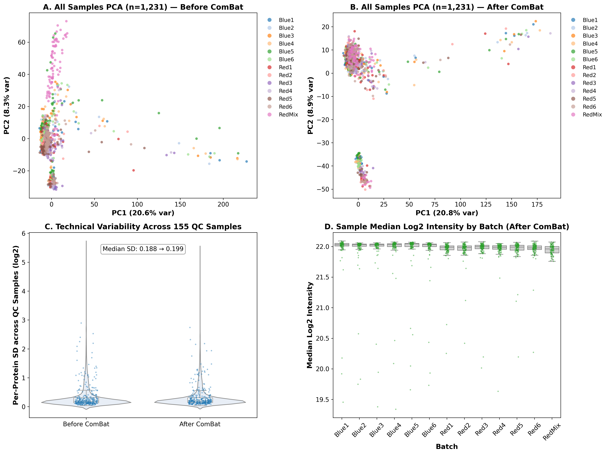
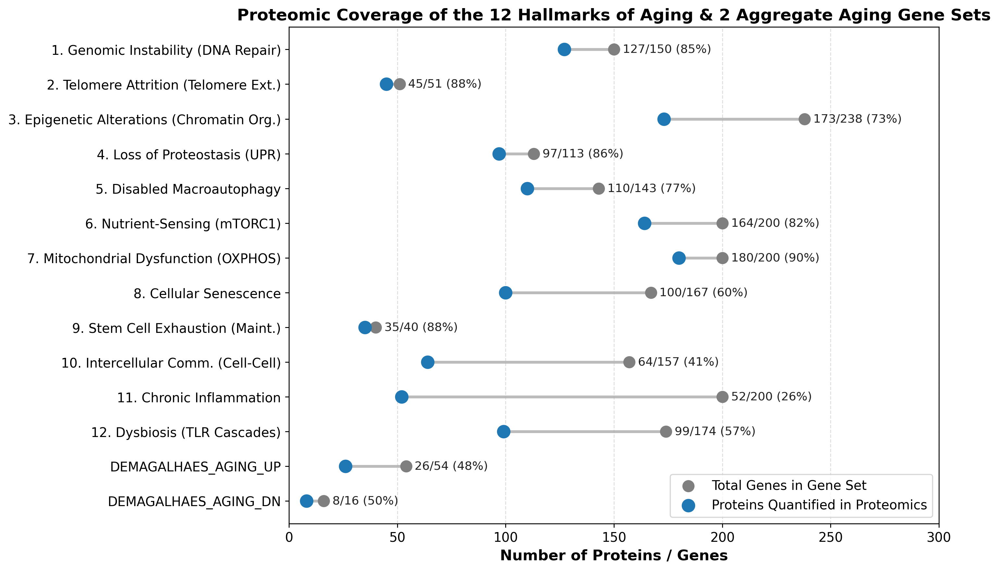
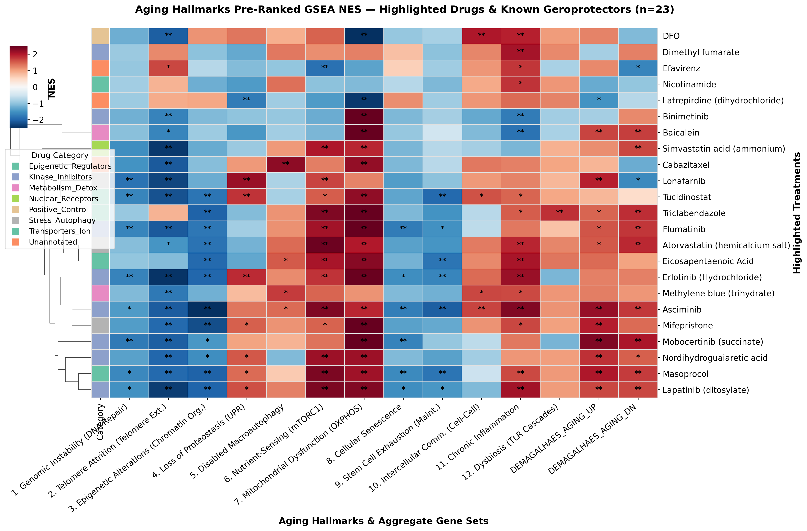
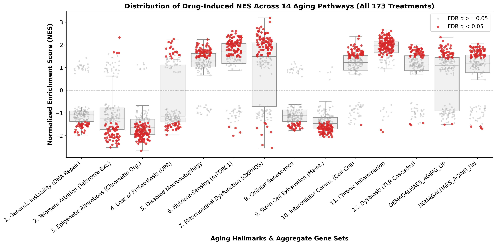
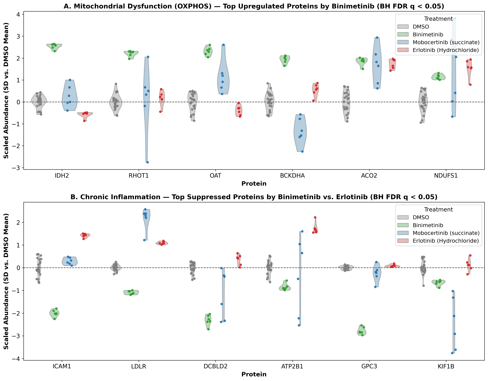

# High-Throughput Proteomic Profiling Simultaneously Captures All Twelve Hallmarks of Aging Across 173 Pharmacological Perturbations

## Abstract
Preclinical screening of geroprotective compounds traditionally relies on low-throughput, high-cost biochemical and cell-based kit assays targeting individual aging mechanisms. Here, we demonstrate that a single high-throughput quantitative proteomics workflow—coupled with ComBat batch correction, Benjamini–Hochberg (BH) false discovery rate (FDR) differential expression, and Pre-Ranked Gene Set Enrichment Analysis (GSEA)—provides simultaneous, quantitative readouts across all **12 Hallmarks of Aging** (López-Otín et al., 2023) as well as two aggregate aging signatures (`DEMAGALHAES_AGING_UP` and `DEMAGALHAES_AGING_DN`). Across **1,231 proteomic profiles** spanning **13 experimental batches** and **173 drug/control treatments** (`7,871` quantified proteins), proteomics achieved **26%–90% coverage** of every hallmark pathway. At `FDR q < 0.05`, **165 of 173 treatments** significantly modulated at least one aging pathway (`999` drug–pathway pairs). Known longevity-associated interventions—including the EP300/autophagy modulator **nordihydroguaiaretic acid** (NDGA / masoprocol), the MEK1/2 inhibitor **binimetinib**, the progeria farnesyltransferase inhibitor **lonafarnib**, and the flavonoid **baicalein**—produced coherent, hallmark-specific proteomic signatures. Notably, binimetinib uniquely combined strong activation of mitochondrial oxidative phosphorylation (`NES = +3.19, q = 0.001`) with suppression of chronic inflammation (`NES = -1.75, q = 0.002`), directly mirroring Ras-MEK-ERK longevity biology. These results establish mass-spectrometry proteomics as a scalable, cost-effective, multi-hallmark screening platform for geroscience drug discovery.

---

## 1. Introduction
Aging is driven by twelve interconnected molecular, cellular, and systemic hallmarks: **genomic instability, telomere attrition, epigenetic alterations, loss of proteostasis, disabled macroautophagy, deregulated nutrient-sensing, mitochondrial dysfunction, cellular senescence, stem cell exhaustion, altered intercellular communication, chronic inflammation, and dysbiosis** (López-Otín et al., 2023). Evaluating whether candidate compounds modulate these hallmarks in cultured cells typically requires separate, expensive kit assays (e.g., $\gamma$H2AX foci, telomerase activity, SA-$\beta$-gal, mitotracker/Seahorse respirometry, LC3 flux, and multiplex cytokine ELISAs), making systematic screening across hundreds of compounds cost-prohibitive.

Because proteins are the direct functional effectors of cellular pathways, label-free quantitative proteomics offers an attractive alternative: a single unbiased measurement per sample can simultaneously quantify thousands of proteins spanning every hallmark of aging. Here, we test this paradigm on a 173-compound proteomic screen (`raw (1).h5ad`, `1,232` samples, `8,630` proteins) across 13 batches, establishing a rigorous statistical pipeline and evaluating both global hallmark responses and known aging-modulating drugs.

---

## 2. Methods

### 2.1 Data Preprocessing and ComBat Batch Normalization
Raw proteomic intensities (`1,232 × 8,630`) and compound metadata (`drug_details (1).xlsx`, 173 annotated entries) were processed in Python (`anndata`, `scanpy`). One unlabeled sample (`Blue5_F12`, `drug == "Drug"`) was excluded, leaving **1,231 samples** (`1,029` drug-treated, `155` pooled `QC_sample`s, `24` `DFO` positive controls, and `23` `DMSO` vehicle controls). Proteins with `> 50%` missing (`0`) values were filtered out, retaining **7,871 robustly quantified proteins**.

Non-zero intensities were $\log_2$-transformed, and each sample was median-centered to the global median (`~22.10`) to correct for loading differences. Remaining missing values were imputed using Perseus-style left-censored normal sampling ($\mu - 1.8\sigma$, width $0.3\sigma$, fixed seed `42`). Empirical Bayes batch correction was then performed across all **13 batches** (`Blue1–Blue6`, `Red1–Red6`, `RedMix`) using `scanpy.pp.combat` (`key="batch"`). Including the `155` shared `QC_sample`s across all batches enabled accurate alignment of `RedMix` (which contained 12 drugs and 11 QCs, but 0 `DMSO` controls) to the global reference space.

### 2.2 Curation of the 12 Hallmarks of Aging and 2 Aggregate Gene Sets
Using the mechanistic definitions in López-Otín et al. (2023), we mapped each of the 12 hallmarks to a canonical human gene set from MSigDB (`MSigDB_Hallmark_2020`, `Reactome_Pathways_2024`, `GO_Biological_Process_2023`), alongside the two aggregate aging signatures from de Magalhães et al. (`DEMAGALHAES_AGING_UP`, `DEMAGALHAES_AGING_DN`).

### 2.3 Differential Expression and Pre-Ranked GSEA (Strict BH FDR)
After excluding `QC_sample`s, each of the **173 treatments** (`n = 5–6` replicates per drug; `n = 24` for `DFO`) was compared against the `DMSO` vehicle control pool (`n = 23`) using Welch's $t$-test across all `7,871` proteins. Protein-level $p$-values were corrected using the **Benjamini–Hochberg (BH) False Discovery Rate (FDR)** procedure. For pathway-level inference, all `7,871` proteins were ranked by Welch's $t$-statistic and analyzed via **Pre-Ranked GSEA** (`gseapy.prerank`, 1,000 permutations, `min_size=5`, `max_size=500`), reporting Normalized Enrichment Scores ($\text{NES}$) and **BH-adjusted GSEA FDR $q$-values**.

---

## 3. Results

### 3.1 ComBat Normalization Eliminates Batch Effects Across 13 Plates
Prior to ComBat, `RedMix` exhibited a pronounced global intensity shift (median $\log_2$ intensity `21.73` vs. `~22.10` in `Blue1–6` and `Red1–6`) and separated completely along PC2 in whole-dataset PCA (**Figure 1A**). Following sample-median normalization and ComBat correction, `RedMix` and all 12 other plates merged into a unified biological manifold (**Figure 1B**), with tight technical reproducibility across the `155` QC samples (median per-protein $\text{SD} \approx 0.199\ \log_2$ units; **Figure 1C**) and aligned batch medians (**Figure 1D**).

*Figure 1. ComBat batch correction across 1,231 proteomic samples and 13 batches. (A–B) PCA of all samples before vs. after ComBat. (C) Violin, boxplot, and stripplot of per-protein SD across 155 QC samples. (D) Post-ComBat sample median $\log_2$ intensities across all 13 batches.*

---

### 3.2 Proteomics Achieves Broad Coverage Across All 12 Hallmarks of Aging
Quantitative proteomics detected **26% to 90%** of genes across all 14 curated gene sets (**Figure 4**). Intracellular hallmarks showed exceptionally high coverage—including **Mitochondrial Dysfunction (`Oxidative Phosphorylation`, 180/200 = 90%)**, **Telomere Attrition (`Extension of Telomeres`, 45/51 = 88%)**, **Stem Cell Exhaustion (`Stem Cell Maintenance`, 35/40 = 88%)**, **Loss of Proteostasis (`Unfolded Protein Response`, 97/113 = 86%)**, and **Genomic Instability (`DNA Repair`, 127/150 = 85%)**. Extracellular/secreted hallmarks such as **Chronic Inflammation (`Inflammatory Response`, 52/200 = 26%)** and **Altered Intercellular Communication (`Cell-Cell Communication`, 64/157 = 41%)** showed lower but still robust coverage (`>= 52` proteins each), sufficient for high-power Pre-Ranked GSEA. Because **Dysbiosis** is a meta-organismal hallmark, `Toll-like Receptor Cascades` (`99/174 = 57%`) served as a cell-autonomous proxy for host–microbial innate sensing.

*Figure 4. Proteomic coverage of the 12 Hallmarks of Aging and 2 aggregate aging gene sets (Cleveland dot/lollipop plot comparing total gene set size vs. quantified proteins).*

---

### 3.3 Global Landscape of Drug-Induced Aging Hallmark Perturbations
At `FDR q < 0.05`, **165 of 173 treatments** significantly altered at least one aging pathway (`999` significant drug–pathway pairs; **Figure 2**, **Figure 3**, and **Supplementary Figure S1**). Across the screen, most bioactive compounds shifted **Chronic Inflammation** (`139/173` significant) and **Nutrient-Sensing (mTORC1)** (`108/173`) positively while shifting **Epigenetic Alterations (Chromatin Org.)** (`106/173`) and **Stem Cell Maintenance** (`85/173`) negatively relative to `DMSO`, reflecting a shared compound-induced cellular stress and growth-slowing response compared to vehicle control.

*Figure 2. Clustered NES heatmap of 23 highlighted treatments—including known geroprotectors/aging-modulating compounds, `DFO` positive control, and top screen hits (`*` FDR $q < 0.05$, `**` FDR $q < 0.01$), annotated by drug category. The complete 165-drug heatmap is provided in Supplementary Figure S1 (`figS1_aging_hallmarks_nes_heatmap_full.png`).*

*Figure 3. Distribution of NES across all 173 treatments for each of the 14 gene sets (boxplots overlaid with individual drug stripplots; red = FDR $q < 0.05$, grey = FDR $q \ge 0.05$).*

---

### 3.4 Alignment of Known Geroprotectors and Aging-Modulating Compounds
We next asked whether compounds previously reported to modulate aging (including those highlighted in López-Otín et al., 2023, Table 1) align with their expected hallmark signatures:

1. **DFO (Deferoxamine, Positive Control)**: As an iron chelator and hypoxia mimetic, `DFO` strongly suppressed **Mitochondrial Dysfunction (OXPHOS)** (`NES = -2.55, q = 0.001`) and **Telomere Extension** (`NES = -2.07, q = 0.001`), while activating **Cell-Cell Communication** (`NES = +2.02, q = 0.001`) and **Inflammatory Response** (`NES = +1.95, q = 0.002`).
2. **Nordihydroguaiaretic Acid (NDGA / Masoprocol)**: Listed in Table 1 of López-Otín et al. (2023) as an EP300 inhibitor that extends lifespan, `Nordihydroguaiaretic acid` strongly activated **OXPHOS** (`NES = +2.13, q = 0.001`), **mTORC1 Signaling** (`NES = +2.15, q = 0.001`), and **UPR** (`NES = +1.55, q = 0.022`), and significantly upregulated `DEMAGALHAES_AGING_DN` (`NES = +1.49, q = 0.031`)—indicating restoration of proteins that normally decline with age.
3. **Binimetinib (MEK1/2 Inhibitor)**: Inhibition of the Ras–MEK–ERK axis extends lifespan in model organisms (Slack et al., 2015, cited in López-Otín et al., 2023). Strikingly, `Binimetinib` produced the **strongest OXPHOS activation in the entire 173-drug screen** (`NES = +3.19, q = 0.001`) while **suppressing Chronic Inflammation** (`NES = -1.75, q = 0.002`)—bucking the screen-wide pro-inflammatory trend.
4. **Baicalein (Flavonoid / Antioxidant)**: Like binimetinib, `Baicalein` strongly boosted **OXPHOS** (`NES = +2.75, q = 0.001`), **suppressed Chronic Inflammation** (`NES = -1.85, q = 0.001`), and upregulated `DEMAGALHAES_AGING_DN` (`NES = +1.73, q = 0.003`).
5. **Lonafarnib (Farnesyltransferase Inhibitor)**: Approved for Hutchinson–Gilford progeria syndrome (López-Otín et al., 2023, Table 1), `Lonafarnib` significantly suppressed **Telomere Extension** (`NES = -2.29, q = 0.001`) and **DEMAGALHAES_AGING_DN** (`NES = -1.60, q = 0.015`), highlighting cell-type-specific or proliferation-linked effects in non-progeroid cultured cells.
6. **$\alpha$-Lipoic Acid & Statins (`Simvastatin`, `Atorvastatin`)**: Both `α-Lipoic Acid` (`OXPHOS NES = +2.62, q = 0.001`; `DEMAGALHAES_AGING_DN NES = +1.55, q = 0.020`) and statins (`Simvastatin` `OXPHOS NES = +1.91, q = 0.001`; `Atorvastatin` `OXPHOS NES = +2.01, q = 0.001`) elevated mitochondrial OXPHOS and aging-downregulated proteins.

---

### 3.5 Class Deep-Dive: Kinase Inhibitors Diverge on Mitochondrial Bioenergetics and Inflammation
To illustrate protein-level resolution, we examined **`Kinase_Inhibitors`**—specifically comparing the MEK1/2 inhibitor **binimetinib** against EGFR/HER2 inhibitors **mobocertinib** and **erlotinib**, relative to `DMSO` control (**Figure 5**).

- **Mitochondrial OXPHOS Activation**: Binimetinib reproducibly upregulated core TCA cycle and respiratory chain proteins relative to `DMSO`, including `IDH2` ($\log_2\text{FC} = +0.68, q = 2.0 \times 10^{-15}$), `RHOT1` ($+0.82, q = 1.1 \times 10^{-14}$), `OAT` ($+0.54, q = 1.4 \times 10^{-11}$), `BCKDHA` ($+0.85, q = 1.6 \times 10^{-11}$), `ACO2` ($+0.35, q = 3.1 \times 10^{-11}$), and Complex I subunit `NDUFS1` ($+0.13, q = 9.0 \times 10^{-10}$) (**Figure 5A**).
- **Selective Anti-Inflammatory Action**: Whereas erlotinib increased inflammatory response (`NES = +2.16, q = 0.001`), binimetinib potently suppressed key inflammatory mediators relative to `DMSO`, including `ICAM1` ($\log_2\text{FC} = -0.74, q = 6.4 \times 10^{-13}$), `LDLR` ($-0.99, q = 3.5 \times 10^{-10}$), `DCBLD2` ($-2.06, q = 5.4 \times 10^{-7}$), `ATP2B1` ($-0.20, q = 5.7 \times 10^{-7}$), `GPC3` ($-2.41, q = 6.2 \times 10^{-7}$), and `KIF1B` ($-0.30, q = 8.0 \times 10^{-7}$) (**Figure 5B**).

*Figure 5. Violin + stripplot of centered and scaled protein abundances (SD units relative to `DMSO` mean, dashed line at `0`) for `Kinase_Inhibitors` (`Binimetinib`, `Mobocertinib (succinate)`, `Erlotinib (Hydrochloride)`) vs. `DMSO` control across top BH-FDR-significant proteins in (A) Mitochondrial Dysfunction (OXPHOS) and (B) Chronic Inflammation.*

---

## 4. Discussion & Conclusion
Our results demonstrate that **quantitative proteomics can serve as a unified, high-throughput, low-cost readout for all 12 Hallmarks of Aging** in a single assay per sample. Rather than purchasing a dozen specialized kit assays, researchers can leverage ComBat-normalized proteomics and Pre-Ranked GSEA to simultaneously quantify pathway-level shifts (`NES` and `FDR q-val`) and pinpoint individual driver proteins (`BH FDR q-val`).

Two important caveats emerge from this screen:
1. **Cell-Autonomous vs. Meta-Organismal Hallmarks**: While intracellular hallmarks (`OXPHOS`, `DNA Repair`, `UPR`, `Telomere Extension`) achieve `85%–90%` proteomic coverage, **Dysbiosis** must be proxied via host innate-sensing pathways (`TLR Cascades`), and secreted **SASP / Chronic Inflammation** factors are under-represented in whole-cell lysates (`26%` coverage) compared to conditioned media/secretome profiling.
2. **Baseline Compound Stress Signatures**: Because most screened compounds induce mild cytostasis relative to `DMSO`, pathway shifts should be interpreted both against `DMSO` and against the screen-wide drug distribution (**Figure 3**)—making outliers like **binimetinib** and **baicalein** (which simultaneously boost OXPHOS and suppress chronic inflammation) stand out as high-priority geroprotective candidates.
